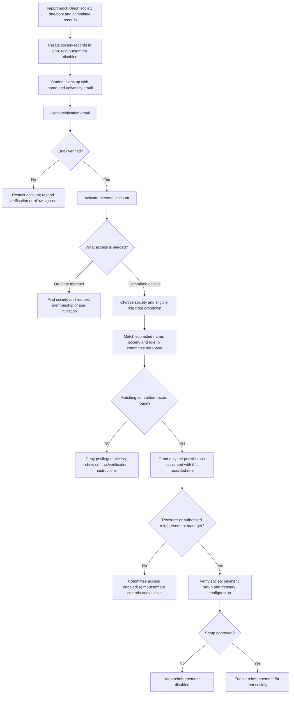
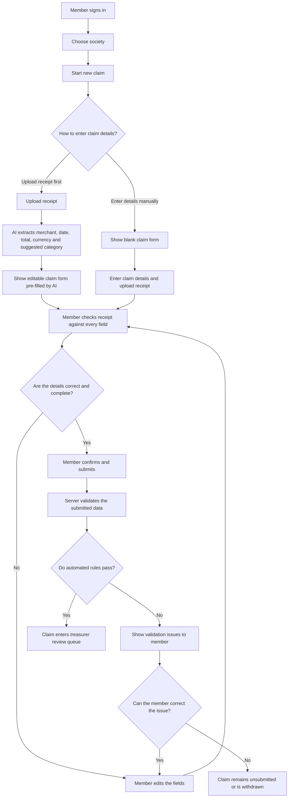
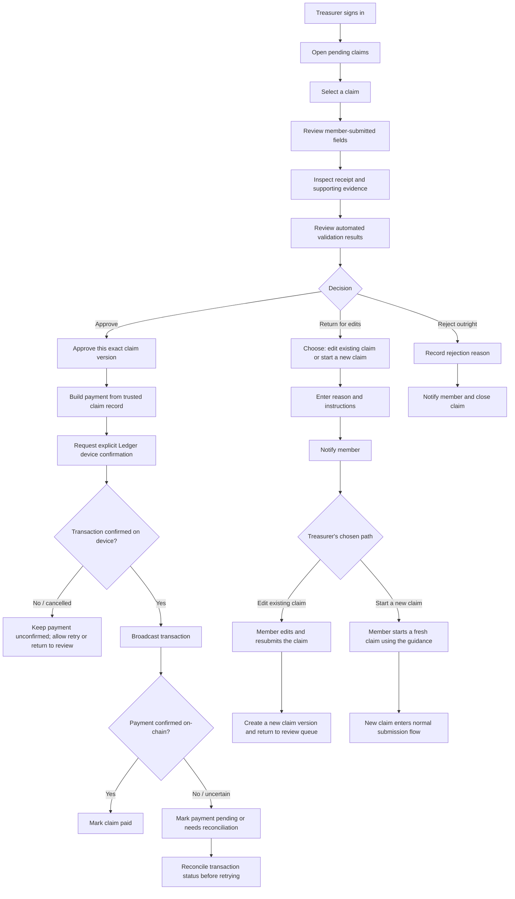

# Society Reimbursement — User Flows

This document describes the MVP flows for onboarding students and society committee members, enabling societies for reimbursement, and submitting and reviewing reimbursement claims.

For the MVP, assume the Students’ Association / Union already maintains a directory of societies and a committee database. Seed the application with **mock society and committee records** that represent these existing sources. The application should match against those records rather than asking Union staff to recreate societies or committee roles manually.

## 0. Onboarding: verify students and committee access

### Data available to the MVP

- **Society directory:** existing society IDs, names and basic status. Imported societies are registered in the app, but reimbursement is disabled by default.
- **Committee records:** mock records linked to a society, containing the person's recorded name and eligible committee role. For the MVP, include only roles that need this system, such as **Treasurer** and **Logistics Coordinator**; do not offer bespoke roles that do not need reimbursement access.
- **University email:** each user must verify control of their university email address before their account is treated as verified.

### Onboarding flow

### Identity and role-verification rules

- **Verify university email ownership** using a verification link or code before enabling account access. Do not treat merely typing a university email address as verification.
- Use the verified email as the account's unique sign-in identifier. Match the person's submitted name, selected society and selected eligible role against the existing committee record.
- The role dropdown is populated from a fixed allowlist (for example, Treasurer and Logistics Coordinator), filtered to roles relevant to the selected society. Do not let users type arbitrary role names or grant themselves permissions.
- A matching name alone is not sufficient proof of identity. If committee records do not contain verified university email addresses, use the email verification plus the committee-record match as the MVP check, and send ambiguous or mismatched cases for manual confirmation through an established Union/committee contact. Never automatically grant privileged access on a failed or ambiguous match.
- Grant least-privilege permissions: a Logistics Coordinator should not automatically receive payment approval or treasury signing permissions unless the policy explicitly grants them. Restrict claim approval and payment initiation to authorised roles.
- A successful committee match does **not** automatically enable reimbursement. The society's authority and payment setup must be checked separately; keep reimbursement disabled until that step is complete. If USDC is used, configure the treasury wallet and Ledger signing process separately.
- Record role claims, verification outcomes, permission changes and reimbursement enablement in an audit log.

## 1. Society member: create and submit a claim

The member can enter the details manually or upload the receipt first and let AI pre-fill the form. In either case, **the member checks and corrects every field before submitting**.

### Member responsibilities

- Upload a receipt or enter the claim details manually.
- Treat AI values as suggestions, not verified facts.
- Check and edit the merchant, date, amount, currency, category and any other required fields.
- Confirm the claim is accurate before submission.
- If a treasurer returns the claim, follow the treasurer's instructions to edit the existing claim or start a new one.

## 2. Treasurer: review a submitted claim

The treasurer reviews the member-confirmed claim, receipt and validation results. AI extraction is shown as context if useful, but it is **not a substitute for the member-confirmed fields or the receipt**.

### Treasurer decision meanings

- **Approve:** The submitted claim is acceptable. Approval must be bound to that exact claim version, amount, recipient, token and network.
- **Return for edits:** The treasurer believes the claim may be corrected. They choose whether to preserve the existing claim for editing or require a fresh claim.
- **Reject outright:** The claim will not proceed. The treasurer records a reason; the member is notified.

For the MVP, you could combine “return for edits” and “reject outright” into a single action with a required resolution choice, but make the resulting next step explicit to the member.

## 3. Shared claim lifecycle

```mermaid
stateDiagram-v2
    [*] --> Draft
    Draft --> AIExtraction: Receipt uploaded first
    AIExtraction --> MemberReview: Fields pre-filled
    Draft --> MemberReview: Manual entry
    MemberReview --> Draft: Member edits
    MemberReview --> Submitted: Member confirms and submits
    Submitted --> Validation
    Validation --> Draft: Validation issue; member can correct
    Validation --> PendingTreasurerReview: Checks pass
    PendingTreasurerReview --> Approved: Treasurer approves exact version
    PendingTreasurerReview --> ReturnedForEdits: Treasurer requests edits
    ReturnedForEdits --> MemberReview: Edit existing claim
    ReturnedForEdits --> Draft: Start a new claim
    PendingTreasurerReview --> Rejected: Treasurer rejects outright
    Approved --> AwaitingLedgerConfirmation
    AwaitingLedgerConfirmation --> PaymentPending: Device confirms and transaction broadcasts
    AwaitingLedgerConfirmation --> Approved: Cancelled or not confirmed; retry later
    PaymentPending --> Paid: On-chain confirmation
    PaymentPending --> PaymentNeedsReconciliation: Unknown or failed outcome
    PaymentNeedsReconciliation --> PaymentPending: Reconciled; safe to continue
    Paid --> [*]
    Rejected --> [*]
```

## 4. Important implementation rules

- **AI does not submit or approve claims.** It only suggests extracted fields.
- **The member confirms the fields before submission.**
- The treasurer reviews the submitted details and receipt; the treasurer does not silently edit member data.
- When a member edits a returned claim, create a new version and require treasurer review again. A previous approval must not carry over.
- Bind payment approval to the exact approved claim version, amount, recipient, token and network. Do not construct a payment from fresh browser values or untrusted AI output.
- Use the recipient wallet address saved in the member's account, not an address found in receipt text.
- Do not mark a claim **Paid** merely because a transaction was requested or broadcast; wait for on-chain confirmation.
- If a transaction's outcome is uncertain, reconcile its status before retrying to avoid paying twice.

## 5. Suggested MVP screens

1. **Sign-up and email verification:** name, university email, verification state and resend-verification action.
2. **Society directory and membership:** search imported society records and request membership or join by invitation.
3. **Committee access request:** choose society and an eligible role from a dropdown; show whether the committee-record match succeeded or requires manual confirmation.
4. **Society setup / reimbursement enablement:** show committee authority and payment-setup status; keep reimbursement disabled until required checks pass.
5. **Member — New claim:** receipt upload, AI extraction/loading state, editable fields, receipt preview and submit button.
6. **Member — My claims:** status, treasurer feedback, and an **Edit claim** or **Start new claim** action when instructed.
7. **Treasurer — Review queue:** pending claims with amount, society, submitter, age and status.
8. **Treasurer — Claim detail:** submitted fields, receipt, validation checks, approve action, and return/reject actions with reason and resolution choice.
9. **Treasurer — Payment status:** awaiting Ledger confirmation, payment pending, paid, or needs reconciliation.
